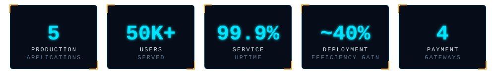

 
 

**Nikhil Kumar Singh** · Java Backend Engineer · Spring Boot · Microservices · Kafka · AWS

## About

Java backend engineer with **2+ years** of professional and internship experience building scalable REST APIs and microservices. I specialize in event-driven systems, distributed transactions, secure authentication, and production payment integrations, deployed on AWS with Docker and automated CI/CD.

## Technical Skills

| Area | Technologies |
|---|---|
| **Languages** | Java (Collections, Multithreading, CompletableFuture, Streams, Virtual Threads), JavaScript |
| **Frameworks** | Spring Boot, Spring MVC, Spring Security, Spring Cloud Gateway, Hibernate / JPA, Node.js, Hapi.js |
| **Architecture** | REST API Design, Microservices, Event-Driven Architecture, Saga Pattern, Distributed Transactions, API Gateway (Spring Cloud Gateway, KrakenD), Service Discovery (Eureka) |
| **Messaging** | Apache Kafka, RabbitMQ, gRPC |
| **Data** | PostgreSQL, MySQL, MongoDB, MSSQL, Cassandra, Redis, Elasticsearch |
| **Security** | JWT, RBAC, OAuth 2.0, Refresh Token Rotation, Rate Limiting, Webhook Signature Verification, Idempotency |
| **Cloud and DevOps** | AWS (EC2, S3), Docker, Docker Compose, GitHub Actions CI/CD, Nginx, Linux |
| **Integrations** | Razorpay, Square, Place to Pay, ATH Móvil, Stripe, Twilio, SendGrid |
| **Frontend** | React, Next.js, Redux Toolkit, Tailwind CSS |
| **Tooling** | Git, Maven, IntelliJ IDEA, Jira, Confluence |

## Experience

### Software Developer · Narola Infotech
*January 2025 – Present*

- Designed and built REST APIs and microservices with Java, Spring Boot, and Hibernate/JPA.
- Implemented asynchronous service communication with Apache Kafka and RabbitMQ.
- Built distributed transaction workflows using the Saga Pattern and compensating transactions.
- Implemented JWT authentication, RBAC, and refresh-token rotation.
- Integrated Razorpay with webhook verification and idempotency to prevent duplicate processing.
- Added Redis caching to reduce API latency and database load.
- Containerized services with Docker and automated CI/CD with GitHub Actions, cutting deployment time by ~40%, on AWS.

**Outcome:** 5 production applications · 50,000+ users · 99.9% uptime
**Systems delivered:** `DONRIFA` `ENIRA` `ALICE` `HIVEONE` `ERP Automation` `OCR System`

### Web Development Intern · TechnoHacks EduTech, CodSoft, Bharat Intern
*July 2023 – September 2023*

## Projects

| Project | Stack | Highlights |
|---|---|---|
| **Banking Microservices** | `Java` `Spring Boot` `Kafka` `PostgreSQL` | Saga Pattern, compensating transactions, event-driven communication, idempotent consumers |
| **Salon Booking Platform** | `Spring Boot` `Cloud Gateway` `Eureka` `PostgreSQL` `Docker` | Six services (users, salons, categories, services, bookings, payments) with service discovery and gateway routing |
| **Job Application Portal** | `Spring Boot` `Kafka` `Redis` `JWT` | API Gateway, refresh-token rotation, caching, event messaging, Razorpay integration |
| **Real-Time Chat Application** | `Java` `RabbitMQ` `Redis` | Concurrent messaging with asynchronous queues and caching |
| **Redis Caching Module** | `Java` `Redis` | Caching layer that reduces API response times |
| **E-Commerce Application** | `MERN` `Redux` `Stripe` | Cart management, payments, automated email workflows |
| **AgroNet** | `MERN` | Direct farmer-to-buyer marketplace: listings, orders, authentication |
| **GenAI Applications** | `Node.js` `AI APIs` | Text, image, and audio generation via asynchronous pipelines |

## Payment Integrations

| Gateway | Region | Implementation |
|---|---|---|
| **Square** | US / Global | Payments API, Orders API, OAuth 2.0, webhook handling |
| **Place to Pay** | Latin America | Session-based checkout, status polling, HMAC validation |
| **ATH Móvil** | Puerto Rico | Production payment request flow and callback handling |
| **Razorpay** | India | Orders API, capture, refunds, UPI, cards, webhook verification |

Across all gateways: full payment lifecycle handling, webhook-driven order reconciliation, idempotent processing, defensive error handling and logging, a unified payment service abstraction, and PCI-oriented design (raw card data is never stored).

## Recognition

- **Agile Person of the Team 2026**, Narola Infotech, for Agile/Scrum ownership and delivery
- **Employee of the Month**, Narola Infotech, for consistent performance and ownership
- **200+ DSA problems solved** across LeetCode, CodeChef, and GeeksforGeeks, with a 100-day LeetCode streak badge

## Education

**B.Tech, Computer Science and Engineering** · Sandip University, Nashik · Graduated 2025 · CGPA 9.11

## Contact

 

